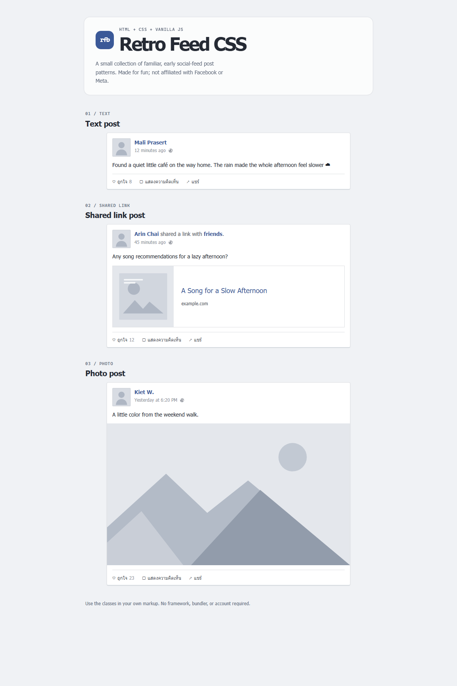

# Retro Facebook CSS

A framework-free recreation of a classic social feed post using HTML, CSS, and vanilla JavaScript — for fun, not affiliated with Facebook or Meta.

All names in the demo are fictional; included images are neutral placeholders.

## Screenshot



## Live demo

[Open the GitHub Pages demo](https://YOUR-USERNAME.github.io/retro-facebook-css/)

Replace `YOUR-USERNAME` with your GitHub username and enable Pages from the repository's **Settings → Pages**.

## Quick start

Open [`index.html`](index.html) directly in a browser. There is no install or build step.

To reuse a post in your own page, copy the component markup and include the stylesheet:

```html
<link rel="stylesheet" href="css/retro-fb.css">

<article class="rfb-post">
  <header class="rfb-post__header">
    
    <div class="rfb-post__meta">
      <span class="rfb-post__name">Mali Prasert</span>
      <p class="rfb-post__time">12 minutes ago</p>
    </div>
  </header>
  <div class="rfb-post__body"><p>Your post text goes here.</p></div>
</article>
```

Include `js/demo.js` only if you want the demo like and comment controls.

## Customize

Override these variables in your own stylesheet after `retro-fb.css`:

| Variable | Default | Use |
| --- | --- | --- |
| `--rfb-color-blue` | `#3b5998` | Names and links |
| `--rfb-color-text` | `#1d2129` | Main post text |
| `--rfb-color-secondary` | `#4b4f56` | Secondary text and actions |
| `--rfb-color-muted` | `#90949c` | Timestamps and counts |
| `--rfb-color-border` | `#dddfe2` | Card and divider borders |
| `--rfb-color-preview` | `#f6f7f9` | Comment area background |
| `--rfb-color-card` | `#fff` | Post card background |
| `--rfb-color-placeholder` | `#d8dce3` | Placeholder image background |
| `--rfb-demo-bg` | `#f0f2f5` | Demo page background; adapts to dark mode |
| `--rfb-demo-text` | `#252a34` | Demo page text |
| `--rfb-demo-muted` | `#606a7a` | Demo page secondary text |
| `--rfb-demo-surface` | translucent white | Demo header surface |
| `--rfb-font-ui` | `"lucida grande", tahoma, verdana, arial, "Noto Sans Thai", sans-serif` | UI font stack |
| `--rfb-font-mono` | `"Cascadia Code", Consolas, monospace` | Demo labels |
| `--rfb-size-xs` / `--rfb-size-sm` | `11px` / `12px` | Small labels and metadata |
| `--rfb-size-base` / `--rfb-size-lg` | `14px` / `18px` | Body and preview title |
| `--rfb-size-title` | responsive `30–48px` | Demo heading |
| `--rfb-card-width` | `640px` | Maximum post width |
| `--rfb-avatar-size` | `48px` | Avatar size |
| `--rfb-link-image-size` | `160px` | Square link thumbnail size |
| `--rfb-radius` | `4px` | Card corner radius |

The demo page background follows the operating system's light or dark preference. The retro post cards keep their white background and original palette.

## Components

All component classes use the `rfb-` prefix and BEM-style element names.

### Text post

```html
<article class="rfb-post">
  <header class="rfb-post__header">
    
    <div class="rfb-post__meta"><span class="rfb-post__name">Mali Prasert</span></div>
  </header>
  <div class="rfb-post__body"><p>A short status update.</p></div>
</article>
```

### Shared link post

```html
<a class="rfb-link-preview" href="https://example.com/">
  
  <span class="rfb-link-preview__content">
    <span class="rfb-link-preview__title">A linked page title</span>
    <span class="rfb-link-preview__domain">example.com</span>
  </span>
</a>
```

### Photo post

```html

```

### Comment list and action bar

```html
<div class="rfb-post__actions">
  <button class="rfb-post__action" type="button">ถูกใจ</button>
  <button class="rfb-post__action" type="button">แสดงความคิดเห็น</button>
  <button class="rfb-post__action" type="button">แชร์</button>
</div>
<section class="rfb-comments">
  <p class="rfb-comments__item"><span class="rfb-comments__name">Niran K.</span> Nice post!</p>
  <button class="rfb-comments__more" type="button">ดูความคิดเห็นเพิ่มเติม</button>
</section>
```

For your own images, add files under `assets/` and point the `src` to the file, or set a CSS `background-image: url('assets/your-image.jpg')`. The included placeholders are abstract SVG shapes, not photos.

## License

Released under the [MIT License](LICENSE).

---

# Retro Facebook CSS (ภาษาไทย)

ตัวอย่างหน้าฟีดโพสต์สไตล์โซเชียลยุคเก่า เขียนด้วย HTML, CSS และ vanilla JavaScript — ทำขึ้นเพื่อความสนุก ไม่ได้เป็นพันธมิตรกับ Facebook หรือ Meta

ชื่อทั้งหมดในเดโมเป็นชื่อสมมติ และรูปที่ให้มาเป็นภาพ placeholder แบบกลาง ๆ

## ภาพตัวอย่าง


## เดโมออนไลน์

[เปิดเดโม GitHub Pages](https://YOUR-USERNAME.github.io/retro-facebook-css/)

เปลี่ยน `YOUR-USERNAME` เป็นชื่อผู้ใช้ GitHub แล้วเปิด Pages ใน **Settings → Pages** ของ repository

## เริ่มใช้งาน

เปิด [`index.html`](index.html) ด้วยเบราว์เซอร์ได้เลย ไม่ต้องติดตั้งหรือ build

นำ markup ของคอมโพเนนต์ไปใช้ในหน้าเว็บของคุณ และเพิ่ม stylesheet:

```html
<link rel="stylesheet" href="css/retro-fb.css">

<article class="rfb-post">
  <header class="rfb-post__header">
    
    <div class="rfb-post__meta">
      <span class="rfb-post__name">มะลิ ประเสริฐ</span>
      <p class="rfb-post__time">12 นาทีที่แล้ว</p>
    </div>
  </header>
  <div class="rfb-post__body"><p>ข้อความโพสต์ของคุณ</p></div>
</article>
```

เพิ่ม `js/demo.js` เฉพาะเมื่อต้องการให้ปุ่มถูกใจและความคิดเห็นในเดโมทำงาน

## ปรับแต่ง

กำหนดค่า CSS variables เหล่านี้ใน stylesheet ของคุณ หลัง `retro-fb.css`:

| ตัวแปร | ค่าเริ่มต้น | ใช้สำหรับ |
| --- | --- | --- |
| `--rfb-color-blue` | `#3b5998` | ชื่อและลิงก์ |
| `--rfb-color-text` | `#1d2129` | ข้อความโพสต์ |
| `--rfb-color-secondary` | `#4b4f56` | ข้อความรองและปุ่ม |
| `--rfb-color-muted` | `#90949c` | เวลาและจำนวนถูกใจ |
| `--rfb-color-border` | `#dddfe2` | เส้นขอบการ์ด |
| `--rfb-color-preview` | `#f6f7f9` | พื้นหลังส่วนความคิดเห็น |
| `--rfb-color-card` | `#fff` | พื้นหลังโพสต์ |
| `--rfb-color-placeholder` | `#d8dce3` | พื้นหลังรูป placeholder |
| `--rfb-demo-bg` | `#f0f2f5` | พื้นหลังหน้าเดโม ปรับตามโหมดมืด |
| `--rfb-demo-text` | `#252a34` | ข้อความหน้าเดโม |
| `--rfb-demo-muted` | `#606a7a` | ข้อความรองหน้าเดโม |
| `--rfb-demo-surface` | ขาวโปร่งแสง | พื้นหลังส่วนหัวเดโม |
| `--rfb-font-ui` | `"lucida grande", tahoma, verdana, arial, "Noto Sans Thai", sans-serif` | ชุดฟอนต์ |
| `--rfb-font-mono` | `"Cascadia Code", Consolas, monospace` | ป้ายกำกับ |
| `--rfb-size-xs` / `--rfb-size-sm` | `11px` / `12px` | ข้อความขนาดเล็ก |
| `--rfb-size-base` / `--rfb-size-lg` | `14px` / `18px` | เนื้อหาและหัวข้อพรีวิว |
| `--rfb-size-title` | ปรับตามจอ `30–48px` | หัวข้อเดโม |
| `--rfb-card-width` | `640px` | ความกว้างสูงสุดของโพสต์ |
| `--rfb-avatar-size` | `48px` | ขนาดรูปโปรไฟล์ |
| `--rfb-link-image-size` | `160px` | ขนาดภาพพรีวิวสี่เหลี่ยม |
| `--rfb-radius` | `4px` | ความโค้งมุมการ์ด |

พื้นหลังหน้าเดโมปรับตามโหมดสว่างหรือมืดของระบบ ส่วนการ์ดโพสต์ยังคงพื้นหลังสีขาวและชุดสีสไตล์เดิม

## คอมโพเนนต์

คลาสของคอมโพเนนต์ใช้ prefix `rfb-` และตั้งชื่อ element แบบ BEM

### โพสต์ข้อความ

```html
<article class="rfb-post">
  <header class="rfb-post__header">
    
    <div class="rfb-post__meta"><span class="rfb-post__name">มะลิ ประเสริฐ</span></div>
  </header>
  <div class="rfb-post__body"><p>ข้อความสถานะสั้น ๆ</p></div>
</article>
```

### โพสต์แชร์ลิงก์

```html
<a class="rfb-link-preview" href="https://example.com/">
  
  <span class="rfb-link-preview__content">
    <span class="rfb-link-preview__title">ชื่อหน้าลิงก์</span>
    <span class="rfb-link-preview__domain">example.com</span>
  </span>
</a>
```

### โพสต์รูปภาพ

```html

```

### รายการความคิดเห็นและแถบปุ่ม

```html
<div class="rfb-post__actions">
  <button class="rfb-post__action" type="button">ถูกใจ</button>
  <button class="rfb-post__action" type="button">แสดงความคิดเห็น</button>
  <button class="rfb-post__action" type="button">แชร์</button>
</div>
<section class="rfb-comments">
  <p class="rfb-comments__item"><span class="rfb-comments__name">นิรันดร์</span> โพสต์ดีมาก!</p>
  <button class="rfb-comments__more" type="button">ดูความคิดเห็นเพิ่มเติม</button>
</section>
```

ใส่รูปของคุณใน `assets/` แล้วกำหนด `src` ไปยังไฟล์นั้น หรือใช้ CSS `background-image: url('assets/your-image.jpg')` ได้ ไฟล์ placeholder ที่ให้มาเป็น SVG รูปทรงนามธรรม ไม่ใช่ภาพถ่าย

## สัญญาอนุญาต

เผยแพร่ภายใต้ [MIT License](LICENSE)
